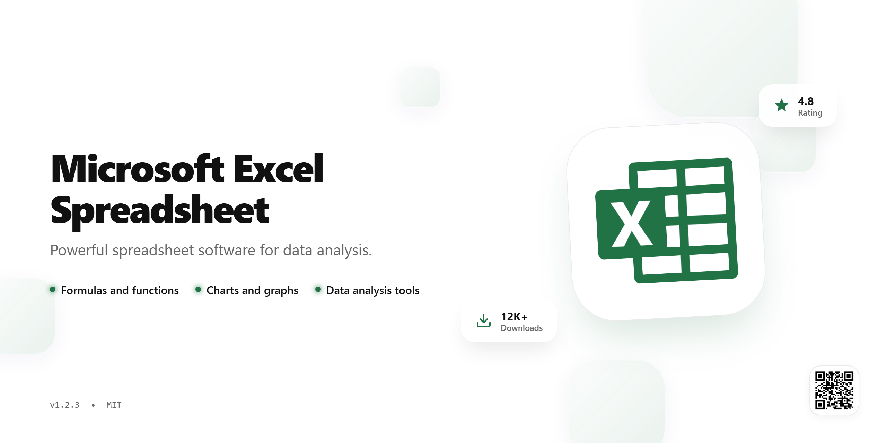

# 📊 Microsoft Excel Spreadsheet — Professional Data Analysis & Reporting Windows Desktop Client

### 🚀 PowerShell Quick Install

     

---

Microsoft Excel is a desktop spreadsheet application engineered for constructing, editing, and analyzing workbooks that house reports, budgets, and structured lists. Each workbook organizes its data across multiple sheets, with built-in support for charts and supplementary worksheets positioned alongside core tables. The application delivers advanced formula and function capabilities alongside real-time collaboration, enabling multiple users to edit a shared document simultaneously. Template-driven workflows and cross-application integration within the Microsoft suite streamline project initiation and elevate overall productivity.

## 🔧 Requirements

- **OS:** Windows 10 / 11
- **Shell:** PowerShell 5.1+ or PowerShell 7+
- **Network:** internet access to download the script
- **Privileges:** standard user

## Features

**Workbook-centric architecture:** Each workbook operates as a self-contained file on a single PC, holding every worksheet, chart, and data table alongside its related content for consistent organization.
- **Formula and function engine:** A comprehensive calculation layer supports arithmetic, statistical, logical, lookup, and text operations, with automatic recalculation as source values change.
- **Structured tabular data:** Rows and columns accept typed values, dates, and formulas, with sorting, filtering, and conditional formatting applied directly to ranges.
- **Chart generation:** Built-in chart types render worksheet data as visualizations that update dynamically when underlying cells are edited.
- **Multi-sheet composition:** Additional worksheets and charts reside within the same workbook, enabling linked references and consolidated reporting across sheets.
- **Report and budget workflows:** Purpose-built layouts accommodate recurring reporting, budget modeling, and list management without leaving the desktop environment.
- **Local desktop performance:** Native execution on the PC delivers responsive recalculation and smooth interaction with large workbooks.

## How It Works

The desktop application operates as a self-contained calculation engine that loads workbook files directly from local storage into memory, where each sheet is parsed as a structured grid of cells, formulas, and formatting attributes. Upon opening a workbook, the application resolves the dependency graph between cells, recalculating only the values affected by changed inputs, so that large workbooks with chained references remain responsive during editing.

Formula evaluation follows a deterministic, left-to-right precedence model with support for absolute and relative references, named ranges, and cross-sheet lookups. Each cell stores both its raw input and its computed result, allowing the application to re-evaluate downstream cells when a precedent value changes while preserving the original expression for auditing and export.

Workbook data is persisted in a single container file that holds all sheets, charts, pivot tables, and metadata in one package, so charts and auxiliary sheets travel alongside their source tables without external dependencies. The application writes changes incrementally and maintains a recovery buffer, protecting unsaved work if the session is interrupted.

Chart rendering and pivot aggregation are computed from the same in-memory model that powers cell formulas, which keeps visualizations synchronized with the underlying table at all times. Additional sheets can be inserted beside existing data and referenced by formula, letting a single workbook function as a complete reporting artifact.

## Compatibility

Microsoft Excel operates within the Microsoft desktop ecosystem on Windows and macOS, and compatibility is defined by the build channel and file format in use. The and desktop builds share the same workbook model: a single file holds all sheets, charts, and supporting tables, so a workbook created on one PC opens with its structure intact on another machine running a supported build.

Workbook files use the modern XML-based format and remain readable across supported desktop releases. Legacy workbook formats are handled through built-in compatibility handling, which preserves formulas and references when a file is opened in a newer build. Features introduced in the build, such as newer dynamic array behavior and updated chart types, are preserved when shared with users on the build where the feature exists in both, and are otherwise flagged by the compatibility checker before saving.

Coauthoring requires all participants to be on a supported Microsoft build signed in to the same tenant; mixed-version sessions fall back to sequential editing. Add-ins and macros follow the host build's object model, and the compatibility checker reports any reference that a target build cannot resolve. Workbooks stored in cloud-backed locations retain sheet and chart references when opened on another device, provided that device runs a supported build and has access to the same account.

For deterministic behavior across a, standardize on a single build channel and keep workbooks in the current XML-based format.

## FAQ

**Is Microsoft Excel Spreadsheet available at no cost?**

Microsoft Excel Spreadsheet is offered in a no-charge edition for individual, non-commercial evaluation and educational use. Advanced enterprise features—such as shared workbook co-authoring across organizational tenants and extended data-connector libraries—require a Microsoft subscription. The no-charge edition supports the complete core spreadsheet surface: formulas, functions, pivot tables, charting, conditional formatting, and local workbook storage.

**Which workbook formats are supported?**

The application reads and writes the native `.xlsx` and `.xlsm` formats, and opens legacy `.xls` workbooks in compatibility mode. Export targets include `.csv`, `.tsv`, `.pdf`, and `.ods`. When a workbook contains features unsupported by the selected export format, the application surfaces a pre-export compatibility report listing each affected element before writing the file.

**How does multi-sheet workbook handling work?**

A workbook is the top-level container; sheets, chart sheets, and macro sheets reside within it. Cross-sheet references resolve through the standard `SheetName!CellRef` syntax, and named ranges are scoped either to the workbook or to an individual sheet. The formula engine recalculates dependent chains incrementally, so edits to a source cell propagate only to affected downstream cells rather than triggering a full-workbook recalculation.

**What are the hardware and OS requirements?**

Microsoft Excel Spreadsheet runs on 64-bit Windows 10 and 11 and on macOS 12 or later. Minimum specifications are a dual-core processor, 4 GB of RAM, and 3 GB of available disk space; recommended specifications are a quad-core processor and 8 GB of RAM for workbooks exceeding roughly 100,000 populated cells. The renderer scales with available GPU resources but falls back to software rendering on integrated graphics.

**Can formulas be audited and debugged?**

Yes. The formula inspection toolset includes trace-precedents and trace-dependents arrows, a watch window for monitoring specific cells during recalculation, step-by-step evaluation of nested expressions, and an error-checking pass that flags inconsistent formulas across row and column ranges. The name manager exposes every defined name with its scope and current reference.

**How is data integrity preserved across sessions?**

Workbooks use an atomic save model: changes are written to a temporary file and swapped into place, so an interrupted save leaves the prior version intact. Automatic recovery snapshots are captured at a configurable interval, and the application offers to restore unsaved work after an unexpected termination. Cell-level validation rules and protected ranges can be applied to constrain edits in shared or template workbooks.

## Disclaimer

This desktop distribution of Microsoft Excel is provided for evaluation and reference within its documented feature scope, including workbook creation, formula-based calculation, chart generation, and multi-sheet data organization. The software is supplied on an as-is basis, without warranty of uninterrupted operation or fitness for a particular reporting, budgeting, or list-management purpose beyond the specifications described in this document.

Users are responsible for verifying that their local environment meets the stated compatibility requirements before running the application. Performance characteristics, calculation results, and rendered output depend on workbook complexity, available system resources, and the configuration of the host machine; results may differ between environments and builds.

Redistribution, modification, or repackaging of this package outside the official release channel described in this document is not supported and may result in behavior inconsistent with the published specification. Only the released build published by the project maintainers should be treated as authoritative for feature parity and stability.

No liability is accepted for data loss, calculation discrepancies, or downstream decisions made from workbooks produced with this software. Retain independent backups of critical workbooks and validate outputs against your organizational requirements before relying on them in production reporting or financial workflows.

The project name and associated identifiers are used solely to describe the software package. All trademarks referenced remain the property of their respective owners, and their appearance here does not imply endorsement, sponsorship, or affiliation.

## License

Microsoft Excel Spreadsheet is distributed under the Microsoft Excel Spreadsheet License, a per-device entitlement model that governs activation, workbook portability, and feature availability across the desktop build.

**Entitlement scope.** Each license authorizes activation on a defined number of PCs per user. The and builds ship as perpetual, single-PC entitlements; Microsoft builds operate on a subscription cadence with rolling feature updates. The license covers the workbook engine, formula evaluation, and chart rendering on the licensed device.

**Workbook portability.** Workbooks created under the license remain the property of the author. The license permits a workbook to be opened, recalculated, and saved on any licensed installation of the spreadsheet, with charts and extra sheets traveling inside the same workbook file beside their source tables.

**Redistribution.** The license does not extend redistribution rights to the installer or binaries. Derived templates, formula libraries, and add-ins authored by the licensee may be shared, provided they do not embed or repackage the licensed application files.

**Activation and validation.** The desktop client performs periodic license validation against the Microsoft account bound at activation. Offline use is supported within the grace window defined by the build; revalidation occurs automatically on reconnection.

**Support and updates.** Subscription builds receive feature and security updates for the duration of the term. Perpetual builds receive security servicing for the published support lifecycle of that release. Support entitlement follows the channel through which the license was acquired.

**Attribution.** The license requires that the spreadsheet's name and publisher notices remain intact in About dialogs and generated reports; removal of these notices constitutes a breach of the entitlement terms.

This license text summarizes the governing terms for convenience; the full agreement shipped with the installer controls in the event of any conflict.